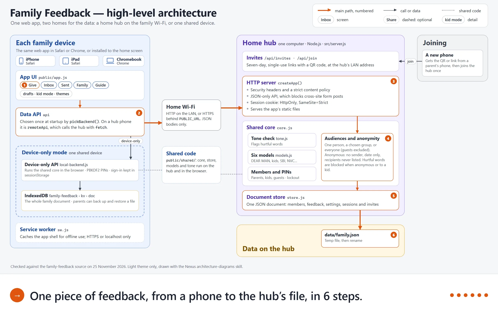
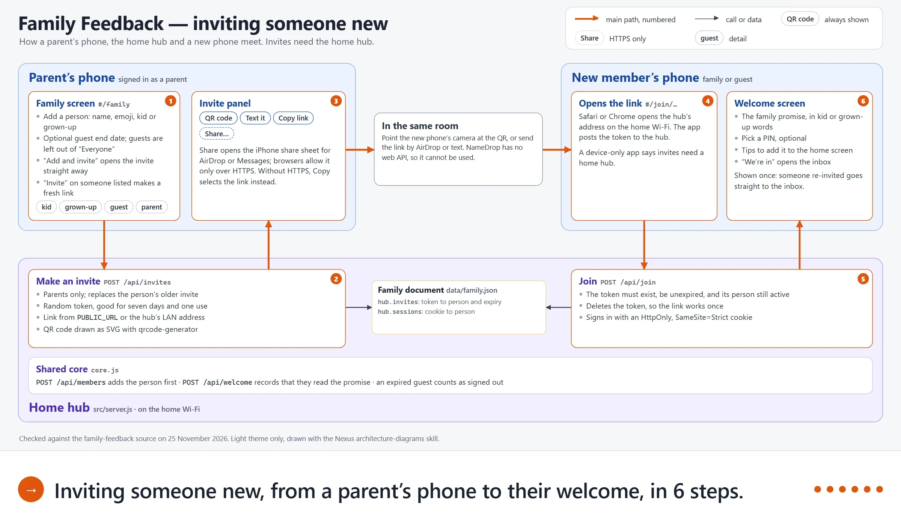

# Architecture diagrams

Two diagrams of Echoes, each a still PNG and an animated WebP that tours the numbered main
path. Diagrams are drawn in light theme only. Their HTML sources were made with a diagram tool
from another project and stay on the maintainer's computer (git ignores them), so they aren't in
this repository.

The animated tours were rendered before the app was renamed, so their title still reads
"Family Feedback"; the still images say Echoes.

## High-level architecture

[Still image](echoes-architecture.png)

How to read it: one piece of feedback, from a phone to the hub's file, in 6 steps.

1. The Give screen sends `POST /api/feedback` with style, words and audience.
2. On a hub phone, `remoteApi` sends it as JSON with `fetch`.
3. The hub checks for JSON, finds the session cookie and calls the core.
4. The core picks recipients and enforces the anonymity and tone rules.
5. The store adds one feedback row per recipient, sharing a group id.
6. The hub writes a temp file, then renames it over `family.json`.

- **Each family device** (left): the same web app on iPhone, iPad or Chromebook. The data
  API (`api`) is chosen once at startup by `pickBackend()`: the hub's `remoteApi`; in
  device-only mode, the shared core running in the browser with the family in IndexedDB; or,
  on a phone linked to a home base, its copy and queue (see the last section).
- **Home Wi-Fi** and **Shared code** (middle): how phones reach the hub, and the
  `public/shared/` files that run on both sides (dotted lines are shared code, not calls).
- **Home hub** (right): the Node.js server, the shared core and the document store, writing
  `data/family.json`. **Joining**: a new phone arrives through an invite link or QR code.

## Inviting someone new

[Still image](echoes-invites.png)

How to read it: inviting someone new, from a parent's phone to their welcome, in 6 steps.

1. A parent taps "Add and invite"; the invite opens straight away.
2. The hub makes a seven-day, single-use link and its QR code.
3. The invite panel offers the QR, Text it, Copy and Share.
4. The new phone scans the QR or opens the link it was sent.
5. The hub checks the token, deletes it and sets a session cookie.
6. First time only: the promise, an optional PIN, then the inbox.

"Invite" beside someone already listed makes a fresh link the same way, from step 2. Someone
re-invited who has already read the promise goes straight to their inbox.

Dashed pills (Share) need HTTPS. Device-only mode has no invite links: people are added on
the home base device, and their own phones are linked to it in person (below).

## Phone as home base (not drawn yet)

With no hub, the device that holds the family is the **home base** and other phones link to
it. The diagrams above don't show this mode yet; in words, one sync goes like this:

1. The home base (`hostFlow` in `public/ui/sync.js`) starts the camera, then makes a WebRTC offer
   and shows it as a QR code (`public/shared/signal.js` compresses it to about 560 characters).
2. The other phone (`joinFlow`) scans it and shows its answer as a QR code; the home base scans that.
3. A data channel opens directly over the Wi-Fi (`public/peer-link.js`; no STUN or relay).
4. The phone says hello with its key. When linking, the home base mints the key instead and
   stores only its hash (`public/shared/peer-host.js`).
5. The phone sends its queued changes in order, then fetches its state, inbox and sent list
   (`public/shared/peer-client.js`). The home base runs each request through the same core as
   the hub, as that person, and refuses sign-in, setup and backups.
6. Until the home base taps Done or leaves Sync, the phone's requests stay live; after that it works from its copy.

Checked against the source on 25 November 2026.
